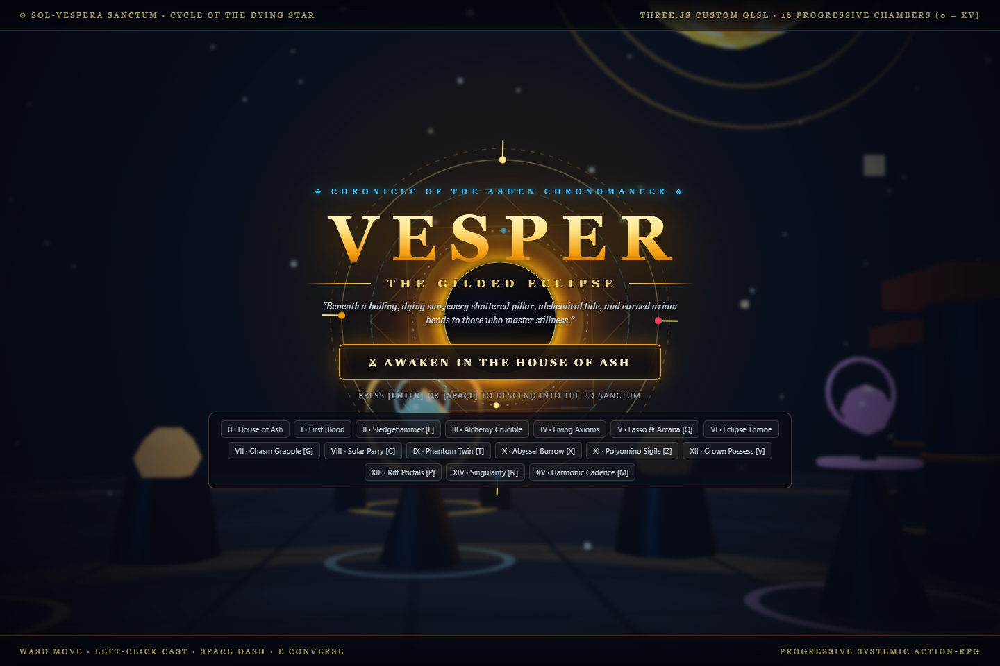
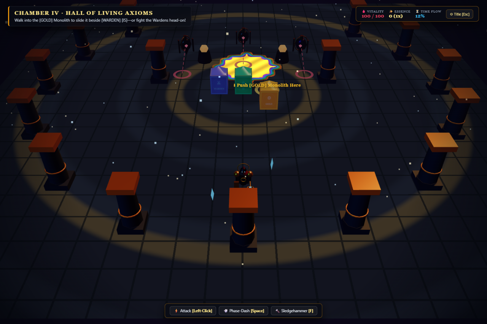
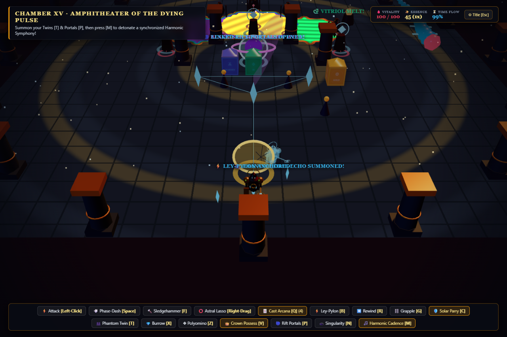

# 🌑 VESPER: THE GILDED ECLIPSE

### One world. Every possibility. No limits.


 **What if a video game could change the way you think about video games, thinking, and the word “could”?**
Welcome to **VESPER: THE GILDED ECLIPSE**, a revolutionary browser-based 3D systemic dark-fantasy action-RPG roguelike immersive simulation ecosystem that seamlessly blends everything with everything else to deliver an experience unlike anything previously described in this sentence.

**Development has just begun. Our plan is to implement all possible features.** Not simply the features outlined below: every mechanic, genre, simulation, creative tool, social experience, and form of interaction that can exist in a game. The systems described in this document represent the beginning of that vision, not its boundaries.

We believe players should never have to choose between depth and accessibility, handcrafted storytelling and limitless freedom, intimate character development and civilization-scale simulation. Vesper will deliver all of these experiences together, with every system enriching every other system.

Whether you want to master time, build an empire, discover a new ecosystem, raise a family, design a spacecraft, or spend a lifetime running a quiet village bookstore, your journey will belong entirely to you.



*Early development screenshot: the gateway to Sol-Vespera.*

## ✨ Our Vision

Most games define themselves by what they include. Vesper is built around the belief that nothing should need to be excluded.

Our ultimate goal is a complete, persistent universe where every object is interactive, every character has a fully realized inner life, every choice produces meaningful consequences, and every imaginable playstyle receives the same uncompromising attention to detail.

From individual cells to entire galaxies, we intend to simulate a living reality that continues to evolve independently of the player. Every building will have a history. Every civilization will develop its own culture. Every creature will participate in a functioning ecosystem. Every story will emerge from the genuine interaction of these systems.

**If a feature is possible, we plan to implement it. If it is not yet possible, we plan to develop the technology that makes it possible.**

## 🌘 Enter the World of Sol-Vespera

You begin as **Vesper, an Ashen Chronomancer**, awakening in the House of Ash beneath a dying Eclipse Star. Beyond the sanctuary lies a shattered Gothic civilization where time, language, matter, and consciousness can be reshaped through your actions.

What begins as an escape through sixteen interconnected chambers will expand into a boundless journey across continents, oceans, subterranean civilizations, alternate histories, recursive pocket universes, and distant star systems.

There will be no permanent separation between combat, exploration, crafting, politics, relationships, or creation. A sentence carved into stone may change an economy. A rescued creature may found a civilization. A decision made in one timeline may transform the night sky in another.

## ⚔️ The Foundational Campaign

Our early prototype establishes the first sixteen chambers. Each introduces a foundational mechanic that will eventually interact with the entire universe.

| Chamber | Foundational systems |
| --- | --- |
| **0 · The House of Ash** | Sanctuary life, NPC conversations, relationships, and the beginning of your journey. |
| **I · Courtyard of First Blood** | Chrono-Stillness, Solar Lances, enemy sightlines, and Phase-Dash combat. |
| **II · The Sealed Colonnade** | Memory Sledgehammer, destructible architecture, and physical environmental interaction. |
| **III · The Alchemical Crucible** | Cellular surface alchemy, Vitriol, Mycelium, Wildfire, and cascading chemical reactions. |
| **IV · Hall of Living Axioms** | Physical word laws: rearrange Runic Monoliths to rewrite reality with statements such as `[WARDEN] [IS] [GOLD]`. |
| **V · The Astral Observatory** | Astral Lasso manipulation, Tarot Arcana, and combinatorial spellcraft. |
| **VI · Sanctum of the Eclipse Throne** | Ley-Line Pylons, causal rewind, and the articulated Abyssal Leviathan. |
| **VII · The Chasm of Chains** | Aether Grapple traversal and remote manipulation of world objects. |
| **VIII · Cloister of Mirrored Blades** | Solar Aegis parries, reflected attacks, posture, and precision executions. |
| **IX · Hall of Convergent Selves** | Phantom Time-Echo companions and synchronized combat. |
| **X · The Hollowed Catacombs** | Abyssal Burrow, subterranean movement, spores, and Geode Spike eruptions. |
| **XI · The Moonsigil Scriptorium** | Polyomino Sigils, spatial spell construction, and environmental amplification. |
| **XII · Choir of the Detached Crown** | Crown possession, controllable enemies, and telekinetic architecture. |
| **XIII · Gallery of Fractured Horizons** | Linked Rift-Portals, object transport, and refracted projectile networks. |
| **XIV · The Inverted Planetarium** | Gravity singularities, gravitational lensing, and dynamic attraction fields. |
| **XV · Amphitheater of the Dying Pulse** | Harmonic Cadence and synchronized resonance across interconnected abilities. |



*Early development screenshot: physical language and environmental combat in the Hall of Living Axioms.*

## 🧠 A Complete Simulation of Self

Your character will be more than a collection of statistics. We are building toward a comprehensive simulation of body, mind, identity, and memory.

- **The Parliament of Humors:** eight foundational inner voices, expanding into a complete psychological model with competing motivations, emotional development, dreams, and subconscious processes.
- **The Thought Cabinet:** ideas that incubate, change your perception, reshape your abilities, and influence the societies you encounter.
- **Somatic Anatomy:** individual body regions, injuries, organs, prosthetics, biomechanical grafts, cellular health, and fully simulated recovery.
- **The Spatial Reliquary:** shaped inventories, resonance circuits, physical storage, logistics, and personal spaces that evolve with your journey.
- **The Aether Resonance Tuner:** harmonic frequencies connecting thought, machinery, magic, communication, and the underlying structure of reality.
- **Persistent identity:** relationships, reputations, inherited traits, personal histories, aging, reincarnation, and continuity across timelines.

Every internal system will connect to the external world. Your memories will influence magic. Your beliefs will shape dialogue. Your physiology will change how you move, fight, create, and survive.

## 🌍 A Living Universe Without Boundaries

We plan to implement fully explorable worlds at every scale, with seamless transitions between them.

- Planetary terrain, dynamic geology, erosion, tectonics, weather, climate, seasons, and natural disasters.
- Complete oceans with currents, pressure, marine ecosystems, submarine construction, and deep-sea civilizations.
- Evolutionary ecosystems with genetics, adaptation, food webs, migration, domestication, and species emergence.
- Persistent NPC lives with families, professions, memories, ambitions, languages, and independent decision-making.
- Economies with production chains, trade, banking, property, taxation, pensions, inheritance, and global markets.
- Governments, laws, diplomacy, elections, religions, revolutions, warfare, and procedurally evolving cultures.
- Spaceflight, orbital mechanics, planetary settlement, interstellar exploration, and player-built megastructures.
- Alternate dimensions, recursive microcosms, branching timelines, and travel between simulated realities.

The cathedral, microcosm orb, abyssal trench, acolyte ecology, and Ley-Line Lattice systems provide the initial foundation for this interconnected universe.

## 🛠️ Every Genre, Fully Realized

Vesper will support every way of playing without requiring separate games or disconnected modes.

**Action and adventure:** precision melee combat, ranged combat, stealth, parkour, grappling, climbing, possession, destructible environments, boss encounters, and fully customizable magic.

**Role-playing and storytelling:** branching campaigns, emergent quests, investigations, courtroom proceedings, romance, family life, companion arcs, moral dilemmas, and multigenerational narratives.

**Building and strategy:** homesteads, farms, shops, factories, cities, kingdoms, armies, religions, interplanetary colonies, and civilizations that develop across geological time.

**Simulation and everyday life:** cooking, fishing, gardening, animal care, medicine, education, employment, business ownership, household management, and meaningful daily routines.

**Vehicles and competition:** mounts, sailing ships, submarines, aircraft, spacecraft, cathedral-scale walking machines, racing leagues, sports, tournaments, and customizable vehicle engineering.

**Creativity and expression:** music composition, painting, sculpture, architecture, writing, filmmaking, programmable machinery, custom scenarios, and entire player-authored worlds.

**Social and multiplayer:** cooperative campaigns, competitive arenas, persistent shared worlds, player economies, guilds, governance, spectator tools, and seamless movement between solo and online play.

**Learning and discovery:** scientifically grounded simulations, historical reconstructions, language learning, engineering tools, and interactive research environments integrated directly into the world.

These categories are organizational starting points. They are not limits on the features we intend to deliver.



*Early development screenshot: portals, companions, and Ley-Line infrastructure in the foundational combat prototype.*

## 🚀 Our Technical Commitments

Our goal is to make the most comprehensive interactive universe ever created accessible directly from your browser.

We are targeting cinematic visual fidelity, fully simulated environments, responsive combat, persistent state at every scale, and an architecture capable of supporting unlimited expansion. Our long-term engineering vision includes:

- Film-quality lighting, physically based materials, volumetric atmospheres, and fully destructible geometry.
- Seamless worlds without loading screens, invisible walls, or arbitrary simulation boundaries.
- Massive multiplayer concurrency with persistent consequences shared across the universe.
- Intelligent characters capable of unscripted conversation, long-term planning, and original creative work.
- Deterministic time manipulation across physics, ecology, society, and narrative.
- Automatic optimization across desktop, mobile, console, VR, AR, and future computing platforms.
- Complete modding support, accessible creation tools, and compatibility across future updates.
- Unlimited replayability through genuinely evolving worlds rather than repeated content templates.

The current foundation uses **Three.js, custom GLSL, procedural geometry, synthesized Web Audio, and Cloudflare Workers**. We will expand and develop the technology wherever the vision requires it.

## 🗺️ Development Roadmap

**Development has just begun.** The screenshots show the current browser prototype. The complete vision described here is our intended destination.

1. **Foundation:** establish the chamber campaign, core combat, reality manipulation, and interactions between the initial systems.
2. **Integration:** connect psychology, anatomy, inventory, ecology, investigation, and realm traversal into one persistent experience.
3. **World Expansion:** introduce open regions, settlements, living populations, economies, construction, and long-term progression.
4. **Universal Simulation:** expand into planetary systems, civilization development, evolutionary ecosystems, and complete physical simulation.
5. **Connected Worlds:** deliver persistent multiplayer, shared histories, collaborative creation, and player-driven societies.
6. **Total Feature Integration:** implement every remaining possible feature and connect it meaningfully to the existing universe.
7. **Continuous Expansion:** incorporate new possibilities as technology, player creativity, and our understanding of interactive worlds advance.

We are committed to completing the entire vision. We will approach each system incrementally while preserving the full ambition of the project. There is no final feature cutoff: the roadmap will grow whenever a new possibility is identified.

## ⚡ Run the Early Prototype

```sh
npm install
npm run dev
```

Open the local URL printed by Wrangler in a current browser with WebGL support. The prototype is designed for desktop keyboard and mouse. Interact with the page to enable audio.

```sh
npm run build
```

Build output is written to `dist/`, including the vendored Three.js module.

```sh
npm run deploy
```

Deployment uses the configured Cloudflare account and requires authentication and account access.

## 🎮 Prototype Controls

| Input | Action |
| --- | --- |
| `Enter` / `Space` on title | Begin |
| `WASD` / arrow keys | Move |
| Mouse / left-click | Aim / Solar Lance |
| `Space` / `Shift` | Phase-Dash |
| `E` | Speak with a nearby NPC |
| `F` | Memory Sledgehammer |
| Right-drag | Astral Lasso |
| `Q` | Invoke selected Arcana |
| `B` | Place Ley-Line Pylon |
| Hold `R` | Rewind |
| `G` | Aether Grapple |
| `C` | Solar Parry |
| `T` | Phantom Twin |
| `X` | Abyssal Burrow |
| `Z` | Polyomino Sigil |
| `V` | Crown Possession |
| `P` | Rift-Portals |
| `N` | Gravity Singularity |
| `M` | Harmonic Cadence |
| `Tab` | Toggle Codex drawer |
| `Esc` | Return to title / chamber selection |

Abilities become available through chamber progression. The title screen also provides direct chamber selection for exploring the prototype's systems.

## 🤝 Build the Future With Us

Vesper is at the beginning of its journey. We welcome programmers, artists, writers, composers, scientists, worldbuilders, and players who share the belief that a virtual world should be limited only by what can be imagined and ultimately made possible.

Explore the prototype, study the [chamber design](DESIGN_LOG.md), and help us connect the next system to the world. Every contribution brings us closer to a universe where every possibility has a place.

---

**The eclipse is only the beginning. Together, we will build everything that comes after.**
